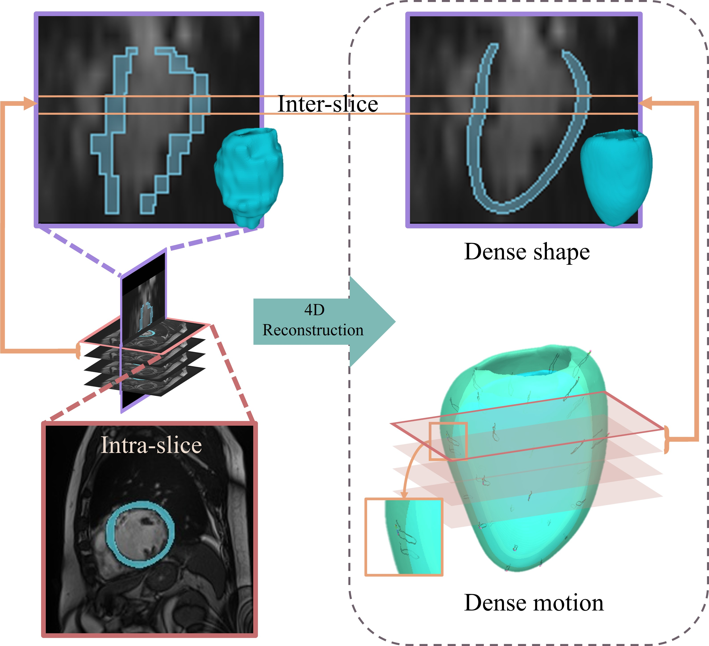

# 4D Myocardium Reconstruction (4DMM)

[4D Myocardium Reconstruction with Decoupled Motion and Shape Model (ICCV 2023)](https://openaccess.thecvf.com/content/ICCV2023/papers/Yuan_4D_Myocardium_Reconstruction_with_Decoupled_Motion_and_Shape_Model_ICCV_2023_paper.pdf)

<div align="center">
  
</div>

> [!IMPORTANT]
> **🚀 NEW — Endo/epi 4DMM release pipeline**
>
> This release keeps the original 4DMM decoder and latent optimization while
> adding independent endocardial and epicardial models, mask preprocessing,
> base stitching, labeled VTK output, and fixed-camera videos.

Given a sequence of 3D cardiac segmentation masks, the pipeline reconstructs
the left-ventricular myocardium as a 3D mesh at every cardiac phase.

## Installation

```bash
conda env create -f environment.yml
conda activate 4DMM-release
```

Run all commands from the repository root.

## Inference

The bundled endocardial and epicardial checkpoints were trained on the
official ACDC training set and evaluated on the held-out ACDC test set.

### Input

Place each case's mask sequence in its own directory:

```text
inputs/
└── CaseA/
    └── mask/
        ├── 00.nii.gz
        ├── 01.nii.gz
        └── ...
```

The alternative layout `inputs/mask/<case>/*.nii.gz` is also supported;
`mask` and `masks` are interchangeable.

Mask labels are `0=background`, `1=RV cavity`, `2=LV myocardium`, and
`3=LV cavity`. All frames in a case must have matching image geometry. The
validated workflow uses phase `00` as the end-diastolic temporal reference.

### Run

Run all discovered cases, or select one:

```bash
python run_pipeline.py
python run_pipeline.py --case CaseA
```

Use `--config`, `--input-root`, and `--output-root` for custom locations. Run
`python run_pipeline.py --help` for the complete command-line interface.

Settings and per-case overrides are in [configs/cases.json](configs/cases.json).
Anatomical reflection (`mirror`) and apex-to-base slice direction (`slice_order`)
are estimated automatically. If the mesh is severely distorted or misplaced,
check these estimates in `report.json` and override them if needed.

### Output

```text
outputs/CaseA/
├── vtk/frame_*.vtk
├── codes/
└── report.json
```

Outputs include labeled meshes, shape/motion codes, and a report containing
the normalization transform and processing results. Mesh labels follow the
fixed interface described below.

If postprocessing fails for a phase, the pipeline saves the unchanged raw
surfaces as a diagnostic VTK, retains codes and intermediate files, and reports
the failure. Processing continues with subsequent phases.

Videos are disabled by default. Set `stages.video=true` to generate an overlay
video and reference-frame PNG under `Mesh_video/` during the run.

## Training on Your Own Data

The model can be trained on a custom 4D cardiac dataset. Before training, each
case must be converted to the required mesh interface:

```text
Your Dataset/
└── <case>/
    ├── mask/
    │   ├── 00.nii.gz
    │   └── ...
    ├── mesh/
    │   ├── frame_00.vtk
    │   └── ...
    └── P.txt
```

Every VTK frame must contain the fixed cell labels:

```text
surface_id: 0=epi, 1=endo
label:      1=epi, 2=endo
```

`P.txt` stores one case-level normalization transform shared by every frame.
If it is absent, `process_data.py` generates it once from the reference-phase
Mask (phase 0 by default). If it is already present, the existing transform is
reused. Masks are not needed for training when the meshes are labeled and
`P.txt` is provided.

Prepare the data and start training:

```bash
python process_data.py \
  --dataset-root "/path/to/Your Dataset" \
  --training-data-root training_data
python train_4dmm.py --training-data-root training_data
```

Endo and epi are trained independently; settings are in
[configs/training.json](configs/training.json). See
[training_data/README.md](training_data/README.md) for the alternative dataset
layout and compatibility with separated normalized epi/endo OBJ files.

## Optional Epi/Endo Labeling

Users are encouraged to prepare and verify the epi/endo labels themselves. If
a combined LV mesh has no labels, the optional helper can estimate them from
the mesh and its corresponding Mask:

```bash
python split_epi_endo.py \
  --mesh input.vtk \
  --mask input.nii.gz \
  --output labeled.vtk
```

The tool preserves points and faces. Its labels are heuristic and must be
reviewed and, if necessary, corrected before training.

## Attribution

```bibtex
@inproceedings{yuan2023myo4d,
  title={4D Myocardium Reconstruction with Decoupled Motion and Shape Model},
  author={Yuan, Xiaohan and Liu, Cong and Wang, Yangang},
  booktitle={Proceedings of the IEEE/CVF International Conference on Computer Vision},
  year={2023}
}
```
